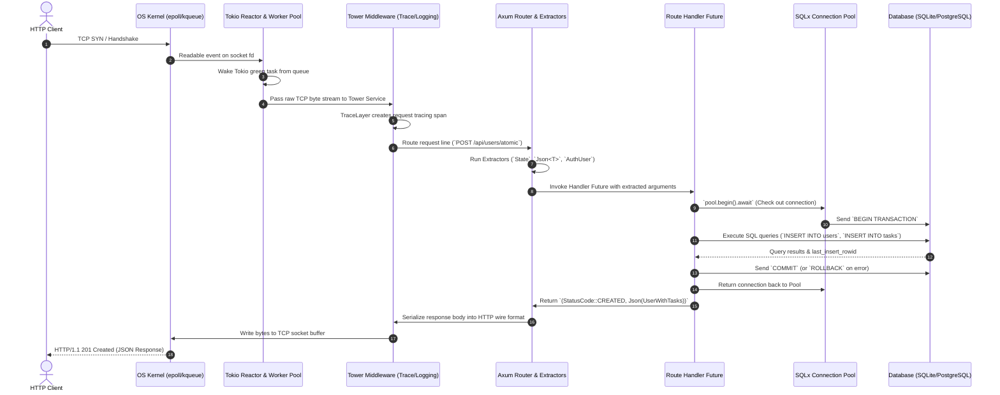

# The Definitive Rust Backend & Interview Preparation Masterclass

Welcome to the comprehensive guide for mastering **Rust backend engineering**, understanding the **inner workings of modern web servers and databases**, and preparing to **ace senior-level technical interviews**.

This guide connects the theoretical language concepts in the Rust Book with real-world production engineering practices demonstrated across this repository.

---

## 📑 Table of Contents
1. [The Anatomy of a Rust Backend (The Full Request Lifecycle)](#1-the-anatomy-of-a-rust-backend)
2. [Concurrency Models Compared: OS Threads vs Go vs Node vs Rust](#2-concurrency-models-compared)
3. [Database Engineering: Connection Pooling, Transactions & SQLite vs Postgres](#3-database-engineering)
4. [Backend Rust Notations, Macros & Trait Rosetta Stone](#4-backend-rust-notations-macros--trait-rosetta-stone)
5. [50 Essential Rust & Backend Interview Questions (With In-Depth Answers)](#5-50-essential-rust--backend-interview-questions)
   - [Part A: Memory Safety, Ownership & Lifetimes](#part-a-memory-safety-ownership--lifetimes)
   - [Part B: Concurrency, Threads & Thread-Safety (`Send`/`Sync`)](#part-b-concurrency-threads--thread-safety-sendsync)
   - [Part C: Async Rust, Tokio & Futures](#part-c-async-rust-tokio--futures)
   - [Part D: Backend Architecture, Databases & HTTP](#part-d-backend-architecture-databases--http)
   - [Part E: Production System Design in Rust](#part-e-production-system-design-in-rust)
6. [Live Coding Challenges: Common Interview Patterns](#6-live-coding-challenges)

---

## 1. The Anatomy of a Rust Backend

When a client sends an HTTP request to an Axum + SQLx service (like [backend_api_service](file:///Users/vinitchuri/code/backend/rust_tutorial/backend_api_service/src/main.rs)), what happens under the hood?



### The Step-by-Step Breakdown:
1. **Socket Ingestion (`tokio::net::TcpListener`)**: The operating system registers incoming packets using kernel event multiplexing (`epoll` on Linux, `kqueue` on macOS). Tokio's I/O driver detects the file descriptor readiness and yields the connection to an active worker thread.
2. **Task Spawning**: Axum spawns a lightweight **Tokio green task** (~300 bytes of stack) to process the connection. Unlike an OS thread (which takes 2–8 MB of memory), a single machine can hold 1,000,000+ simultaneous idle connections.
3. **Middleware Pipeline (Tower)**: Requests flow through onion-layered Tower services:
   - `TraceLayer`: Records request timing, status codes, and request IDs.
   - CORS / Compression / Timeout middleware (if enabled).
4. **Declarative Routing & Type Extractors (`FromRequest`)**:
   - Axum tests the URI and HTTP method against its radix-tree routing table.
   - It runs type extractors **before** the handler function executes:
     - `Path(id)` parses URL slugs.
     - `Json(payload)` streams and deserializes the request body using `serde_json`.
     - `AuthUser` extracts the `Authorization: Bearer <token>` header, verifying credentials.
   - If *any* extractor fails, Axum aborts early and returns a 400 Bad Request or 401 Unauthorized without ever calling your business logic.
5. **Connection Pool Checkout (`sqlx::Pool`)**:
   - When the handler executes `state.pool.begin().await?`, it checks out an idle database connection from the pool.
   - If all connections are in use, the future asynchronously pauses (`yields`) without blocking the CPU thread until a connection is freed.
6. **Atomic Transaction Execution**:
   - Queries execute asynchronously over the borrowed connection.
   - If an error occurs, the transaction object is dropped. SQLx's `Drop` implementation automatically sends `ROLLBACK` to the database, ensuring zero corrupted or orphaned rows.
7. **Response Serialization (`IntoResponse`)**:
   - Handlers return types implementing `IntoResponse`.
   - Enums like `AppError` convert domain failures into standard HTTP status codes (`400`, `401`, `404`, `409`, `500`) and JSON bodies.
   - The connection is cleanly returned to the pool, and the task terminates.

---

## 2. Concurrency Models Compared

One of the most frequent interview questions asks how Rust achieves concurrency compared to other languages:

| Concurrency Model | Languages | How It Works | Strengths | Trade-offs / Weaknesses |
|---|---|---|---|---|
| **OS Thread per Request (1:1)** | Java (pre-Loom), C++, Ruby Puma | Each connection gets its own OS thread scheduled by the kernel. | Simple programming model, no async syntax. | High memory overhead (~2–8 MB stack per thread); context switching kills CPU cache beyond ~5,000 threads. |
| **Single-Threaded Event Loop** | Node.js (V8 / libuv), Python (Asyncio) | A single thread runs an event loop handling non-blocking callbacks. | Low memory per socket, avoids multithreading race conditions. | CPU-heavy work blocks the entire server; cannot scale across multiple CPU cores without clustering processes. |
| **Managed Green Threads (M:N with GC)** | Go (Goroutines) | Go runtime schedules thousands of 2KB goroutines across M OS threads. | Easy syntax (no `async`/`await`), built-in scheduler. | Garbage Collector (GC) introduces unpredictable latency spikes (stop-the-world pauses); runtime overhead. |
| **Zero-Cost Cooperative Async (M:N Safe)** | **Rust (Tokio)** | Futures are state machines compiled by `rustc`. No runtime garbage collector. | **Zero GC pauses**, minimal memory (~300 bytes per task), **compile-time data race prevention** (`Send` + `Sync`). | Explicit `async`/`.await` syntax; blocking the worker thread stalls scheduled tasks; steeper learning curve. |

> [!IMPORTANT]
> **The Golden Rule of Tokio**:
> Tokio uses **cooperative multitasking**. Async tasks only yield execution when encountering an `.await` on an async operation (like network I/O or timers).
> If you execute a heavy CPU calculation (e.g. image processing, password hashing) or call `std::thread::sleep` inside an async handler, **you freeze the underlying OS worker thread**, stalling dozens of other concurrent web requests.
> **Solution**: Offload blocking operations to Tokio's dedicated blocking pool using `tokio::task::spawn_blocking(move || { ... })`.

---

## 3. Database Engineering

### 3.1 Connection Pooling Mechanics
Why not open a database connection every time an HTTP request arrives?
- Establishing a TCP connection and performing SSL handshakes and database authentication takes **10–50 milliseconds**.
- An HTTP handler that takes 2ms of business logic would spend 95% of its time just connecting to the database!
- **Connection Pools (`SqlitePool` / `PgPool`)**:
  - Keep a pre-warmed set of active connections open (e.g. 5 to 50 connections).
  - Loaning a connection from the pool takes **< 0.05 milliseconds** (in-memory pointer checkout).
  - Protects the database from collapsing under traffic spikes by bounding maximum concurrency.


### 3.2 Atomic Transactions & ACID Safety
A database transaction is an all-or-nothing guarantee. In [backend_api_service/src/main.rs](file:///Users/vinitchuri/code/backend/rust_tutorial/backend_api_service/src/main.rs):

```rust
// 1. Begin atomic transaction
let mut tx = state.pool.begin().await?;

// 2. Insert User
let user_id = sqlx::query("INSERT INTO users (username, email) VALUES (?, ?)")
    .bind(username).bind(email)
    .execute(&mut *tx).await?
    .last_insert_rowid();

// 3. Insert Tasks
for title in &payload.initial_tasks {
    if title.is_empty() {
        // Returning Err drops `tx` WITHOUT committing.
        // SQLx's Drop implementation automatically issues a `ROLLBACK`!
        return Err(AppError::BadRequest("Title cannot be empty".into()));
    }
    sqlx::query("INSERT INTO tasks (user_id, title) VALUES (?, ?)")
        .bind(user_id).bind(title)
        .execute(&mut *tx).await?;
}

// 4. Commit transaction
tx.commit().await?;
```

### 3.3 SQLite vs PostgreSQL: Key Differences for Backends

| Feature | SQLite (Used in this Tutorial) | PostgreSQL (Production Standard) |
|---|---|---|
| **Architecture** | Serverless, in-process library. Database is a single file or in-memory (`sqlite::memory:`). | Client-server architecture. Requires separate daemon process and TCP connection. |
| **SQLx Bind Syntax** | `?` (positional): `WHERE id = ?` | `$1, $2, $3`: `WHERE id = $1 AND name = $2` |
| **Concurrency Model** | Single-writer, multiple-readers (with WAL mode). High write concurrency can lock. | Multi-Version Concurrency Control (MVCC). Extremely high concurrent read/write scaling. |
| **Foreign Keys** | Disabled by default. Must enable via `PRAGMA foreign_keys = ON;` or `foreign_keys(true)`. | Always enforced by default. |
| **Advanced Types** | Minimal types (INTEGER, REAL, TEXT, BLOB). | Native UUID, JSONB, ARRAY, TIMESTAMPTZ, ENUM, Full-Text Search. |
| **Switching in SQLx** | `sqlx = { version = "0.8", features = ["sqlite"] }`<br/>`SqlitePool` | `sqlx = { version = "0.8", features = ["postgres"] }`<br/>`PgPool` |

---

## 4. Backend Rust Notations, Macros & Trait Rosetta Stone

| Notation / Syntax | Meaning in Rust Backend Code |
|---|---|
| `#[tokio::main]` | Macro that initializes the multi-threaded Tokio runtime and turns `async fn main()` into a blocking execution loop. |
| `#[derive(Serialize, Deserialize)]` | Serde macro generating compile-time code to convert Rust structs to/from JSON without reflection or runtime cost. |
| `#[derive(FromRow)]` | SQLx macro allowing database rows to be mapped directly to struct fields by column name. |
| `#[utoipa::path(...)]` | Utoipa macro extracting OpenAPI metadata (parameters, responses, tags) to generate Swagger documentation. |
| `?` Operator | Error propagation shorthand: if a `Result` is `Err(e)`, it immediately returns from the current function, running `From::from(e)` to convert the error type. |
| `Arc<AppState>` | Atomic Reference Counted smart pointer. Allows multiple threads to safely share read access to the application state and connection pool. |
| `State<Arc<AppState>>` | Axum state extractor. Injects shared application state into route handlers safely across async tasks. |
| `Path(id)` | Axum path parameter extractor. Deserializes URL slugs (e.g. `/api/users/{id}`) into typed Rust variables (`i64`, `Uuid`). |
| `Json(payload)` | Axum JSON extractor. Reads the request body, checks `Content-Type: application/json`, and parses it into your DTO struct. |
| `&'a str` | String slice with lifetime `'a`. Guarantees the reference does not outlive the owner string, enabling zero-copy string parsing. |
| `dyn Trait` | Dynamic dispatch via Trait Object (fat pointer with vtable). Used for plugin architectures or heterogeneous collections. |
| `impl Trait` | Static dispatch via Monomorphization. The compiler generates a concrete copy of the function for each concrete type, inlining operations at zero runtime cost. |

---

## 5. 50 Essential Rust & Backend Interview Questions

### Part A: Memory Safety, Ownership & Lifetimes

#### 1. What are the three core rules of Rust's ownership system?
1. Each value in Rust has an owner.
2. There can only be one owner at any given time.
3. When the owner goes out of scope, the value is automatically dropped (memory is freed).

#### 2. What is the difference between `Copy` and `Clone`?
- **`Copy`**: A marker trait for types whose data can be duplicated simply by copying bits in memory (`memcpy`). It is implicit, only applicable to fixed-size stack types (e.g. `i32`, `bool`, `f64`, `[u8; 4]`), and cannot be implemented if the type manages heap resources.
- **`Clone`**: An explicit trait (`.clone()`) for duplicating types. It may involve heap allocations and arbitrary logic (e.g. cloning a `Vec<String>`).

#### 3. What is the "Aliasing XOR Mutability" principle?
Rust's borrow checker enforces that at any given point in code, you may have:
- **Either** any number of immutable references (`&T`),
- **Or** exactly one mutable reference (`&mut T`),
- **Never both at the same time.**
This compile-time rule completely eliminates data races, iterator invalidation, and pointer aliasing bugs.

#### 4. What are Non-Lexical Lifetimes (NLL)?
Before Rust 2018, references were considered live until the enclosing curly brace scope `{ ... }` ended. With NLL, the borrow checker analyzes the control flow graph: a borrow ends at the **last point of actual usage**, allowing variables to be borrowed mutably immediately after an immutable reference is done being used.

#### 5. Why are lifetimes (`'a`) needed, and do they change how long a value lives?
Lifetimes **never** change how long a value lives at runtime. They are purely compile-time annotations that describe the relationship between the lifetimes of multiple references so the compiler can ensure a reference never outlives the data it points to (preventing dangling pointers and use-after-free).

#### 6. What are the three Lifetime Elision Rules?
The compiler automatically infers lifetimes for function signatures without requiring explicit `'a` annotations if:
1. Each input parameter that is a reference gets its own lifetime parameter (`fn foo(x: &str, y: &str)` $\to$ `fn foo<'a, 'b>(x: &'a str, y: &'b str)`).
2. If there is exactly one input lifetime, that lifetime is assigned to all output references (`fn foo(x: &str) -> &str` $\to$ `fn foo<'a>(x: &'a str) -> &'a str`).
3. If there are multiple input lifetimes, but one of them is `&self` or `&mut self`, the lifetime of `self` is assigned to all output references.

#### 7. What is `'static` lifetime?
`'static` means the reference can live for the entire duration of the running program. Examples include string literals (`"hello"` baked into the binary's read-only data segment) or heap values intentionally leaked with `Box::leak()`. In trait bounds (`T: 'static`), it means the type owns all its data and contains no non-static references.

#### 8. What is the Null Pointer Optimization (NPO)?
In Rust, `Option<&T>` or `Option<Box<T>>` occupies the **exact same memory size** as a raw pointer (8 bytes on 64-bit systems). Since a valid Rust reference or `Box` can never be null (0x0), the compiler uses the null pointer bit pattern `0x0` to represent `None`, giving you full type-safety with zero memory overhead!

#### 9. What is RAII, and how does Rust implement it?
**Resource Acquisition Is Initialization**. In Rust, resources (heap memory, file descriptors, database connections, mutex locks) are tied to the lifetime of an owner struct. When the struct goes out of scope, Rust automatically calls its `Drop::drop()` method, guaranteeing deterministic cleanup without needing a garbage collector or manual `finally` blocks.

#### 10. Can you prevent a value from being dropped in Rust?
Yes. Using `std::mem::forget(value)` or `std::mem::ManuallyDrop::new(value)`, the destructor is bypassed, which is useful in low-level FFI bindings or when leaking memory intentionally.

---

### Part B: Concurrency, Threads & Thread-Safety (`Send`/`Sync`)

#### 11. What are the `Send` and `Sync` marker traits?
- **`Send`**: Indicates that ownership of the type can be safely transferred across thread boundaries. (Almost all types are `Send`, except types like raw pointers or `Rc<T>`).
- **`Sync`**: Indicates that it is safe to share references to the type across multiple threads concurrently (`&T` is `Send`). A type `T` is `Sync` if and only if `&T` is `Send`.

#### 12. Why is `Rc<T>` not `Send` or `Sync`?
`Rc<T>` uses a standard non-atomic integer for reference counting (`fetch_add` is not used). If two threads cloned an `Rc<T>` simultaneously, a data race on the counter would cause double-frees or memory leaks. `Arc<T>` uses atomic operations (`AtomicUsize`), making it `Send` and `Sync`.

#### 13. What is the difference between `Mutex<T>` and `RwLock<T>`?
- **`Mutex<T>`**: Grants exclusive access to a single thread at a time, blocking all other readers and writers.
- **`RwLock<T>`**: Allows multiple concurrent readers (`read()`) OR one exclusive writer (`write()`). It is ideal for read-heavy, write-infrequent workloads, but can suffer from writer starvation under heavy read traffic.

#### 14. What causes deadlocks in Rust, and can the compiler catch them?
Rust's compiler **does not prevent deadlocks**. A deadlock occurs when Thread 1 locks Mutex A and waits for Mutex B, while Thread 2 locks Mutex B and waits for Mutex A. To prevent deadlocks:
1. Always acquire multiple locks in a globally consistent order.
2. Minimize lock scope (hold the lock only while accessing data).
3. Use `try_lock()` with timeouts.

#### 15. What is the difference between Standard Library Mutex and Tokio Mutex?
- **`std::sync::Mutex`**: Blocks the underlying OS thread when contested. Best used for very short, non-async in-memory operations.
- **`tokio::sync::Mutex`**: Suspends the async task (`.await`) when contested, freeing the OS thread to execute other tasks. **Mandatory** if you need to hold a mutex lock across an `.await` point.

---

### Part C: Async Rust, Tokio & Futures

#### 16. What is a `Future` in Rust?
In Rust, a `Future` is a trait representing an asynchronous computation that produces a value:
```rust
pub trait Future {
    type Output;
    fn poll(self: Pin<&mut Self>, cx: &mut Context<'_>) -> Poll<Self::Output>;
}
```
Rust futures use a **pull-based (poll) model**, not a push-based model (like JavaScript Promises).

#### 17. Why are Rust Futures called "Lazy"?
In JavaScript or C#, calling an async function immediately starts executing work in the background. In Rust, calling an async function does **nothing**; it merely constructs a state machine. Work only begins when the future is explicitly polled via `.await` or spawned onto an executor (`tokio::spawn`).

#### 18. What is `Pin` and why is it necessary for async/await?
When an async function pauses at an `.await`, local variables stored across the suspension point might hold references to other local variables within the same generated future (self-referential structs). If the future were moved in memory, those internal pointers would become invalid (dangling). `Pin` wraps a pointer to guarantee that the underlying value will never be moved in memory again.

#### 19. What is Cancellation Safety in Tokio?
When an async future is dropped before completing (for example, if `tokio::select!` sees another branch finish first, or an HTTP client disconnects), the future is cancelled. An operation is "cancellation safe" if dropping it midway leaves the program in a consistent state without losing data (e.g. reading from a channel or socket without partial consumption).

#### 20. What is the difference between `tokio::spawn` and `tokio::join!`?
- **`tokio::spawn`**: Spawns a new independent background green task on the Tokio runtime. It runs concurrently and requires `T: Send + 'static`.
- **`tokio::join!`**: Polls multiple futures concurrently on the **same** task. If one future yields, the other is polled. It does not require `'static` and preserves borrows.

---

### Part D: Backend Architecture, Databases & HTTP

#### 21. How do you map domain errors to HTTP status codes in Axum?
By creating a custom enum (e.g., `AppError`) and implementing Axum's `IntoResponse` trait. In `into_response()`, match on the error variants (`NotFound` $\to$ 404, `Conflict` $\to$ 409, `Unauthorized` $\to$ 401) and return a tuple `(StatusCode, Json(ErrorResponse))`.

#### 22. What is the N+1 Query Problem and how do you resolve it in Rust?
Executing 1 query to fetch $N$ parent records, and then running $N$ individual queries in a loop to fetch each child record.
- **Resolution**: Use an SQL `JOIN` or fetch all related IDs in a single query using `WHERE user_id IN (...)` and group them in memory using a `HashMap<i64, Vec<Task>>`.

#### 23. What is an Idempotent HTTP Method?
An HTTP method is idempotent if making the same request multiple times produces the identical server state as making it once.
- **Idempotent**: `GET`, `PUT`, `DELETE`, `HEAD`, `OPTIONS`.
- **Non-idempotent**: `POST` (submitting twice creates two resources).

#### 24. How does SQLx guarantee compile-time SQL safety?
When using the `query!` or `query_as!` macros with a connected database or offline metadata file (`sqlx-data.json`), SQLx connects to the database during `cargo build`, prepares the SQL query, and asks the database engine for the exact column types and nullability, ensuring schema mismatch errors are caught before code ever runs.

#### 25. How do you implement Graceful Shutdown in a Rust backend?
By capturing termination signals (`SIGINT` / Ctrl+C and `SIGTERM`) and passing the signal future to Axum's server:
```rust
axum::serve(listener, app)
    .with_graceful_shutdown(shutdown_signal())
    .await?;
```
This stops accepting new incoming connections while allowing ongoing requests to finish before the process terminates.

---

### Part E: Production System Design in Rust

#### 26. How do you design a high-throughput real-time metrics aggregator?
Use an in-memory ring buffer or lock-free queue (`crossbeam-channel`), where HTTP handlers send non-blocking metric events to a dedicated background task that flushes batches to persistent storage every 1 second.

#### 27. How do you prevent connection pool starvation under high load?
1. Configure an `acquire_timeout` (e.g. 3 seconds) so queries fail fast with 503 Service Unavailable rather than hanging indefinitely.
2. Ensure handlers never hold a database connection while performing slow third-party HTTP calls.
3. Keep database transactions as short as possible.

---

## 6. Live Coding Challenges

Below are three classic coding challenges frequently asked during Rust backend interviews.

### Challenge 1: Thread-Safe In-Memory Token Bucket Rate Limiter
**Problem**: Implement an API rate limiter that allows up to $N$ requests per second per IP address, thread-safe across concurrent web requests.

```rust
use std::collections::HashMap;
use std::sync::{Arc, Mutex};
use std::time::{Duration, Instant};

#[derive(Clone)]
pub struct RateLimiter {
    state: Arc<Mutex<HashMap<String, (u32, Instant)>>>,
    max_tokens: u32,
    refill_duration: Duration,
}

impl RateLimiter {
    pub fn new(max_tokens: u32, refill_duration: Duration) -> Self {
        Self {
            state: Arc::new(Mutex::new(HashMap::new())),
            max_tokens,
            refill_duration,
        }
    }

    pub fn check_rate_limit(&self, client_ip: &str) -> bool {
        let mut map = self.state.lock().unwrap();
        let now = Instant::now();

        let (tokens, last_refill) = map
            .entry(client_ip.to_string())
            .or_insert((self.max_tokens, now));

        // Refill tokens if duration has elapsed
        if now.duration_since(*last_refill) >= self.refill_duration {
            *tokens = self.max_tokens;
            *last_refill = now;
        }

        if *tokens > 0 {
            *tokens -= 1;
            true // Allowed
        } else {
            false // Rate limited (429 Too Many Requests)
        }
    }
}
```

### Challenge 2: Zero-Allocation Request Header Scanner
**Problem**: Given a raw HTTP byte buffer, extract the `Host` header without allocating any heap `String`.

```rust
pub fn extract_header_value<'a>(raw_http: &'a str, target_header: &str) -> Option<&'a str> {
    for line in raw_http.lines() {
        if let Some((header_name, header_value)) = line.split_once(':') {
            if header_name.trim().eq_ignore_ascii_case(target_header) {
                return Some(header_value.trim());
            }
        }
    }
    None
}

#[test]
fn test_zero_alloc_header_scanner() {
    let raw = "GET /api/users HTTP/1.1\r\nHost: api.example.com\r\nAccept: application/json\r\n\r\n";
    assert_eq!(extract_header_value(raw, "Host"), Some("api.example.com"));
    assert_eq!(extract_header_value(raw, "Accept"), Some("application/json"));
    assert_eq!(extract_header_value(raw, "Authorization"), None);
}
```

---

## 7. Next Steps & Study Routine

1. **Phase 1 to 4**: Run each crate in order (`cargo run -p <package>`).
2. **Review Compiler Diagnostics**: In `ownership/src/main.rs`, uncomment compile-error snippets and read `rustc --explain`.
3. **Inspect the Full API**: Start the backend service and explore the Swagger UI:
   ```shell
   cargo run -p backend_api_service
   # Open http://localhost:3000/swagger-ui in your browser
   ```
4. **Mock Interview Practice**: Review the 50 interview questions above out loud. If you can explain them clearly in your own words, you are ready for senior Rust backend interviews.
