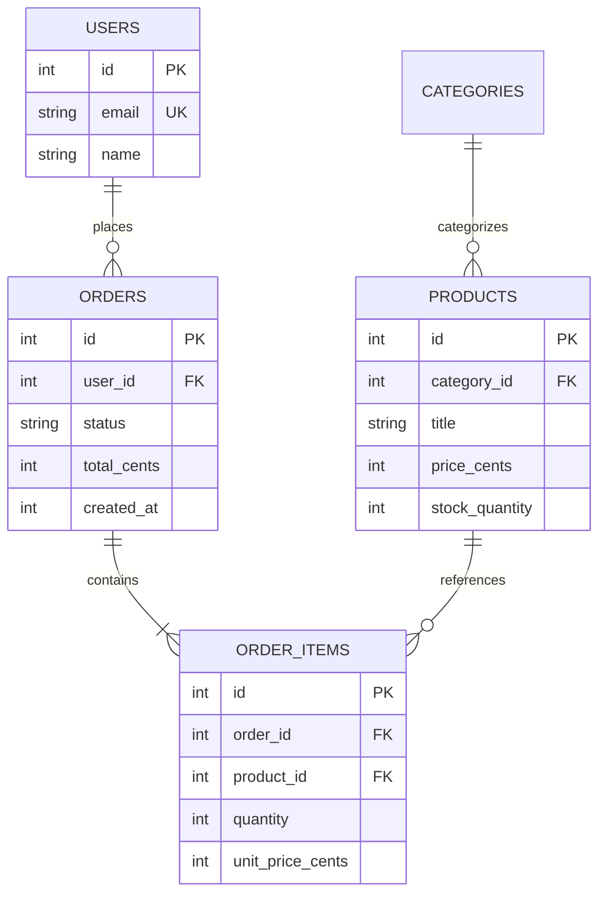
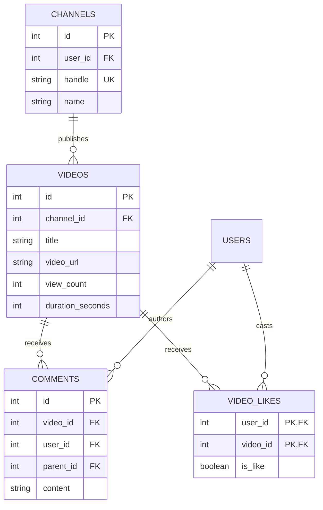

# The Relational Database & SQL Engineering Handbook
### *Everyday SQL, Relational Architecture, and Schema Design for Production Backends (SQLite & PostgreSQL 17–19)*

---

## 📑 Table of Contents
1. [Core Relational Concepts for Backend Engineers](#1-core-relational-concepts-for-backend-engineers)
2. [3 Real-World Domain Architectures](#2-3-real-world-domain-architectures)
   - [Domain A: E-Commerce Architecture (Inventory, Carts, Orders, Transactions)](#domain-a-e-commerce-architecture)
   - [Domain B: YouTube / Streaming Architecture (Channels, Videos, Views, Nested Comments)](#domain-b-youtube--streaming-architecture)
   - [Domain C: R&D / Academic Platform (Papers, Versions, Tags, Collaborations)](#domain-c-rd--academic-platform)
3. [Everyday SQL: The 95% You Write on the Job](#3-everyday-sql-the-95-you-write-on-the-job)
   - [CRUD & The Essential `RETURNING` Clause](#31-crud--the-essential-returning-clause)
   - [Atomic Concurrency & Preventing Race Conditions (Overselling / Double-Spend)](#32-atomic-concurrency--preventing-race-conditions)
   - [Upsert (`ON CONFLICT ... DO UPDATE`)](#33-upsert-on-conflict--do-update)
   - [Pagination: Offset vs Keyset (Cursor-Based)](#34-pagination-offset-vs-keyset-cursor-based)
   - [Soft Deletes vs Hard Deletes](#35-soft-deletes-vs-hard-deletes)
   - [Junction Tables (Many-to-Many Queries)](#36-junction-tables-many-to-many-queries)
   - [Aggregations, Grouping & Filtered Metrics](#37-aggregations-grouping--filtered-metrics)
   - [Common Table Expressions (CTEs) & Recursive Trees](#38-common-table-expressions-ctes--recursive-trees)
   - [Window Functions (`ROW_NUMBER`, `RANK`, Running Totals)](#39-window-functions)
4. [Indexing Strategy & Query Optimization](#4-indexing-strategy--query-optimization)
5. [SQLite vs Modern PostgreSQL (17–19) Feature Matrix](#5-sqlite-vs-modern-postgresql-1719-feature-matrix)
6. [Executing These Queries with Rust & SQLx](#6-executing-these-queries-with-rust--sqlx)

---

## 1. Core Relational Concepts for Backend Engineers

In backend development, databases are not just storage buckets; they are the **source of truth for business invariants**.

### Normalization vs. Intentional Denormalization
- **1NF, 2NF, 3NF (Normalization)**: Eliminate duplicate data by separating entities into discrete tables linked by foreign keys.
  - *Example*: Don't store `author_name` inside the `posts` table. Store `author_id` referencing `users(id)` so renaming a user requires updating only one row.
- **Intentional Denormalization**: In high-read backends (like YouTube or Twitter), computing `COUNT(*)` across 10,000,000 rows on every page load brings down the database. We store counter caches (`view_count INTEGER DEFAULT 0`) directly on the video row, maintained via atomic increments.

### The 4 Relationship Types
1. **One-to-One (1:1)**: `users(id)` $\leftrightarrow$ `user_profiles(user_id UNIQUE)`. Used to separate sensitive auth credentials from public bio/avatars.
2. **One-to-Many (1:N)**: `channels(id)` $\leftrightarrow$ `videos(channel_id)`. The most common backend relationship.
3. **Many-to-Many (M:N)**: `videos(id)` $\leftrightarrow$ `tags(id)`. Modeled via a **Junction / Pivot Table** (`video_tags(video_id, tag_id)`).
4. **Self-Referencing (Hierarchy/Trees)**: `comments(id)` $\leftrightarrow$ `comments(parent_id)`. Enables unlimited nested reply threads.

---

## 2. 3 Real-World Domain Architectures

### Domain A: E-Commerce Architecture

An e-commerce backend must handle catalog discovery, inventory reservation, and atomic checkout without race conditions.



#### DDL Schema (PostgreSQL & SQLite Compatible):
```sql
CREATE TABLE categories (
    id INTEGER PRIMARY KEY AUTOINCREMENT, -- Postgres: id SERIAL PRIMARY KEY
    name TEXT NOT NULL UNIQUE,
    slug TEXT NOT NULL UNIQUE
);

CREATE TABLE products (
    id INTEGER PRIMARY KEY AUTOINCREMENT,
    category_id INTEGER REFERENCES categories(id) ON DELETE SET NULL,
    title TEXT NOT NULL,
    sku TEXT NOT NULL UNIQUE,
    price_cents INTEGER NOT NULL CHECK (price_cents >= 0),
    stock_quantity INTEGER NOT NULL DEFAULT 0 CHECK (stock_quantity >= 0),
    is_active BOOLEAN NOT NULL DEFAULT 1,
    created_at INTEGER NOT NULL
);

CREATE TABLE orders (
    id INTEGER PRIMARY KEY AUTOINCREMENT,
    user_id INTEGER NOT NULL REFERENCES users(id) ON DELETE RESTRICT,
    status TEXT NOT NULL CHECK (status IN ('pending', 'paid', 'shipped', 'cancelled')),
    total_cents INTEGER NOT NULL DEFAULT 0,
    created_at INTEGER NOT NULL
);

CREATE TABLE order_items (
    id INTEGER PRIMARY KEY AUTOINCREMENT,
    order_id INTEGER NOT NULL REFERENCES orders(id) ON DELETE CASCADE,
    product_id INTEGER NOT NULL REFERENCES products(id) ON DELETE RESTRICT,
    quantity INTEGER NOT NULL CHECK (quantity > 0),
    unit_price_cents INTEGER NOT NULL,
    UNIQUE (order_id, product_id)
);
```

---

### Domain B: YouTube / Streaming Architecture

A YouTube-style backend prioritizes high-throughput read traffic, real-time counters, and nested comments.



#### DDL Schema:
```sql
CREATE TABLE channels (
    id INTEGER PRIMARY KEY AUTOINCREMENT,
    user_id INTEGER NOT NULL REFERENCES users(id) ON DELETE CASCADE,
    handle TEXT NOT NULL UNIQUE,
    name TEXT NOT NULL,
    created_at INTEGER NOT NULL
);

CREATE TABLE videos (
    id INTEGER PRIMARY KEY AUTOINCREMENT,
    channel_id INTEGER NOT NULL REFERENCES channels(id) ON DELETE CASCADE,
    title TEXT NOT NULL,
    description TEXT,
    video_url TEXT NOT NULL,
    duration_seconds INTEGER NOT NULL,
    view_count INTEGER NOT NULL DEFAULT 0,
    like_count INTEGER NOT NULL DEFAULT 0,
    published_at INTEGER NOT NULL
);

-- Self-referencing tree for threaded replies:
CREATE TABLE comments (
    id INTEGER PRIMARY KEY AUTOINCREMENT,
    video_id INTEGER NOT NULL REFERENCES videos(id) ON DELETE CASCADE,
    user_id INTEGER NOT NULL REFERENCES users(id) ON DELETE CASCADE,
    parent_id INTEGER REFERENCES comments(id) ON DELETE CASCADE, -- NULL = Top-level comment
    content TEXT NOT NULL,
    created_at INTEGER NOT NULL
);

-- Compound Primary Key prevents duplicate voting:
CREATE TABLE video_likes (
    user_id INTEGER NOT NULL REFERENCES users(id) ON DELETE CASCADE,
    video_id INTEGER NOT NULL REFERENCES videos(id) ON DELETE CASCADE,
    is_like BOOLEAN NOT NULL, -- 1 = Like, 0 = Dislike
    created_at INTEGER NOT NULL,
    PRIMARY KEY (user_id, video_id)
);
```

---

### Domain C: R&D / Academic Platform

An R&D platform tracks research papers, immutable revisions, peer reviews, and taxonomy tags.

```sql
CREATE TABLE research_papers (
    id INTEGER PRIMARY KEY AUTOINCREMENT,
    doi TEXT UNIQUE,
    title TEXT NOT NULL,
    abstract TEXT NOT NULL,
    current_version INTEGER NOT NULL DEFAULT 1,
    status TEXT NOT NULL CHECK (status IN ('draft', 'under_review', 'published', 'archived')),
    created_at INTEGER NOT NULL
);

-- Immutable version history:
CREATE TABLE paper_revisions (
    id INTEGER PRIMARY KEY AUTOINCREMENT,
    paper_id INTEGER NOT NULL REFERENCES research_papers(id) ON DELETE CASCADE,
    version_number INTEGER NOT NULL,
    content_url TEXT NOT NULL,
    change_summary TEXT,
    created_at INTEGER NOT NULL,
    UNIQUE (paper_id, version_number)
);

CREATE TABLE tags (
    id INTEGER PRIMARY KEY AUTOINCREMENT,
    name TEXT NOT NULL UNIQUE
);

-- Many-to-Many junction table:
CREATE TABLE paper_tags (
    paper_id INTEGER NOT NULL REFERENCES research_papers(id) ON DELETE CASCADE,
    tag_id INTEGER NOT NULL REFERENCES tags(id) ON DELETE CASCADE,
    PRIMARY KEY (paper_id, tag_id)
);
```

---

## 3. Everyday SQL: The 95% You Write on the Job

### 3.1 CRUD & The Essential `RETURNING` Clause
Historically, after an `INSERT`, backends had to execute a separate `SELECT last_insert_rowid()` or `SELECT currval()`.
In modern SQL (supported by both PostgreSQL and SQLite 3.35+), always use **`RETURNING`** to get generated values atomically in a single query:

```sql
-- Single query inserts and immediately returns the generated ID & timestamp:
INSERT INTO products (category_id, title, sku, price_cents, stock_quantity, created_at)
VALUES (1, 'Mechanical Keyboard', 'KB-RGB-01', 12900, 50, 1716000000)
RETURNING id, sku, created_at;
```

---

### 3.2 Atomic Concurrency & Preventing Race Conditions
#### The E-Commerce Nightmare: Overselling Inventory
A beginner developer writes:
```sql
-- BAD PATTERN (Race Condition!):
SELECT stock_quantity FROM products WHERE id = 42; -- returns 1
-- App checks: 1 > 0, proceeds to buy...
-- Meanwhile, another user does the exact same thing at the exact same millisecond!
UPDATE products SET stock_quantity = stock_quantity - 1 WHERE id = 42; -- Stock is now -1!
```

#### The Production Pattern: Atomic Conditional Decrement
Write the guard condition directly into the `WHERE` clause:
```sql
-- SAFE & ATOMIC:
UPDATE products 
SET stock_quantity = stock_quantity - 1 
WHERE id = 42 AND stock_quantity >= 1
RETURNING stock_quantity;
```
If `rows_affected() == 0`, stock was exhausted right before your query executed. You reject the order cleanly without needing table locks!

#### Incrementing Counters (YouTube View Counts)
Never read-modify-write counters in application code. Do it on the database engine:
```sql
UPDATE videos 
SET view_count = view_count + 1 
WHERE id = 101;
```

---

### 3.3 Upsert (`ON CONFLICT ... DO UPDATE`)
How does YouTube handle likes? If a user clicks "Like", then clicks "Dislike", you don't want duplicate rows:
```sql
INSERT INTO video_likes (user_id, video_id, is_like, created_at)
VALUES (5, 101, 1, 1716000000)
ON CONFLICT (user_id, video_id) 
DO UPDATE SET 
    is_like = EXCLUDED.is_like,
    created_at = EXCLUDED.created_at;
```
- `EXCLUDED` represents the incoming row that caused the unique constraint conflict.

---

### 3.4 Pagination: Offset vs Keyset (Cursor-Based)

#### Method 1: Offset Pagination (`LIMIT ... OFFSET ...`)
```sql
SELECT id, title, price_cents FROM products 
ORDER BY id ASC 
LIMIT 20 OFFSET 40; -- Page 3
```
- **The Problem**: When `OFFSET` is large (e.g. `OFFSET 1000000`), the database must scan 1,000,020 rows, discard the first 1,000,000 in memory, and return 20. This causes severe latency degradation.

#### Method 2: Keyset / Cursor Pagination (Production Standard)
Instead of skipping rows, filter on the indexed column using the last seen ID:
```sql
-- Fetch the first page:
SELECT id, title, price_cents FROM products 
ORDER BY id ASC 
LIMIT 20;

-- Fetch the next page (passing cursor id = 20 from previous page):
SELECT id, title, price_cents FROM products 
WHERE id > 20 
ORDER BY id ASC 
LIMIT 20;
```
- **Performance**: O(1) B-tree lookup. It executes in **< 1ms** whether on row 20 or row 20,000,000!

---

### 3.5 Soft Deletes vs Hard Deletes
In SaaS and e-commerce, never hard-delete users or orders. Add `deleted_at INTEGER DEFAULT NULL`:

```sql
-- "Delete" an entity:
UPDATE users SET deleted_at = 1716000000 WHERE id = 10;

-- Filter active entities:
SELECT * FROM users WHERE deleted_at IS NULL;
```

> [!TIP]
> **Performance Trick (Partial Indexes)**:
> In PostgreSQL and SQLite, create a partial index so soft-deleted queries stay fast without indexing deleted rows:
> ```sql
> CREATE INDEX idx_users_active_email ON users(email) WHERE deleted_at IS NULL;
> ```

---

### 3.6 Junction Tables (Many-to-Many Queries)
*Question: Find all research papers tagged with 'Rust' and 'Databases':*

```sql
SELECT p.id, p.title, p.doi
FROM research_papers p
JOIN paper_tags pt ON p.id = pt.paper_id
JOIN tags t ON pt.tag_id = t.id
WHERE t.name IN ('Rust', 'Databases')
GROUP BY p.id
HAVING COUNT(DISTINCT t.id) = 2; -- Must have BOTH tags
```

---

### 3.7 Aggregations, Grouping & Filtered Metrics
*Question: For each channel, find total videos, average duration, and total views:*

```sql
SELECT 
    c.id AS channel_id,
    c.name AS channel_name,
    COUNT(v.id) AS total_videos,
    COALESCE(SUM(v.view_count), 0) AS total_views,
    ROUND(AVG(v.duration_seconds), 1) AS avg_duration_seconds
FROM channels c
LEFT JOIN videos v ON c.id = v.channel_id
GROUP BY c.id, c.name
HAVING COUNT(v.id) > 0 -- Only channels with at least 1 video
ORDER BY total_views DESC;
```

---

### 3.8 Common Table Expressions (CTEs) & Recursive Trees

#### Standard CTE (Modular Clean SQL)
```sql
WITH HighValueOrders AS (
    SELECT id, user_id, total_cents 
    FROM orders 
    WHERE total_cents >= 100000 -- $1,000+
)
SELECT u.name, u.email, h.total_cents
FROM HighValueOrders h
JOIN users u ON h.user_id = u.id;
```

#### Recursive CTE: Fetching YouTube Threaded Comments
*Question: Given comment ID 10, fetch the entire reply tree to any depth:*

```sql
WITH RECURSIVE CommentTree AS (
    -- Anchor member: The root comment
    SELECT id, video_id, parent_id, content, 0 AS depth
    FROM comments 
    WHERE id = 10

    UNION ALL

    -- Recursive member: Find all direct children
    SELECT c.id, c.video_id, c.parent_id, c.content, ct.depth + 1
    FROM comments c
    JOIN CommentTree ct ON c.parent_id = ct.id
)
SELECT * FROM CommentTree ORDER BY depth ASC, id ASC;
```

---

### 3.9 Window Functions
Window functions compute aggregates across rows **without collapsing rows like `GROUP BY`**.

#### Example: Find the Top 3 Most Viewed Videos for Every Channel
```sql
WITH RankedVideos AS (
    SELECT 
        channel_id,
        title,
        view_count,
        ROW_NUMBER() OVER (
            PARTITION BY channel_id 
            ORDER BY view_count DESC
        ) AS rank_in_channel
    FROM videos
)
SELECT channel_id, title, view_count, rank_in_channel
FROM RankedVideos
WHERE rank_in_channel <= 3;
```

---

## 4. Indexing Strategy & Query Optimization

Indexes are built on **B-Trees**. 

### When to Index:
- Columns in `WHERE` clauses (e.g. `WHERE email = ?`)
- Columns used in `JOIN` conditions (`ON o.user_id = u.id`)
- Columns used in `ORDER BY`

### Composite Indexes (The Left-Prefix Rule)
If you create an index on `(channel_id, published_at)`:
- `WHERE channel_id = ? AND published_at > ?` $\to$ **Uses Index (Super Fast)**
- `WHERE channel_id = ?` $\to$ **Uses Index**
- `WHERE published_at > ?` $\to$ **Cannot use index!** (Must match left-to-right)

### How to Check Query Performance
- **SQLite**: Prepend `EXPLAIN QUERY PLAN`:
  ```sql
  EXPLAIN QUERY PLAN SELECT * FROM videos WHERE channel_id = 5;
  -- Look for "SEARCH TABLE videos USING INDEX" vs "SCAN TABLE videos" (full table scan)
  ```
- **PostgreSQL**: Prepend `EXPLAIN ANALYZE`:
  ```sql
  EXPLAIN ANALYZE SELECT * FROM videos WHERE channel_id = 5;
  ```

---

## 5. SQLite vs Modern PostgreSQL (17–19) Feature Matrix

| Feature | SQLite (Local / Embedded) | PostgreSQL 17–19 (Production Cloud) |
|---|---|---|
| **Primary Keys** | `INTEGER PRIMARY KEY AUTOINCREMENT` | `BIGINT GENERATED ALWAYS AS IDENTITY` or `UUID` |
| **JSON Support** | `json_extract()`, `json_object()` | `JSONB` with binary containment operators (`@>`, `?`) and indexing |
| **Concurrency** | Single writer lock (WAL mode allows concurrent readers) | Multi-Version Concurrency Control (MVCC) with row-level locks |
| **Date / Time** | Stored as UNIX Epoch seconds (INTEGER) or ISO strings | Native `TIMESTAMPTZ` with timezone awareness |
| **Full-Text Search** | FTS5 virtual tables | Built-in `tsvector`, `tsquery`, GIN indexes |
| **Upsert** | `ON CONFLICT (...) DO UPDATE` | `ON CONFLICT (...) DO UPDATE` |
| **Returning** | `RETURNING *` (supported in SQLite 3.35+) | `RETURNING *` (industry standard) |

---

## 6. Executing These Queries with Rust & SQLx

Here is how you execute these real-world queries in Rust using SQLx:

```rust
// 1. Safe Inventory Reservation (E-Commerce Pattern)
pub async fn purchase_product(
    pool: &SqlitePool,
    product_id: i64,
    quantity: i64,
) -> Result<bool, sqlx::Error> {
    let rows_affected = sqlx::query(
        "UPDATE products 
         SET stock_quantity = stock_quantity - ? 
         WHERE id = ? AND stock_quantity >= ?"
    )
    .bind(quantity)
    .bind(product_id)
    .bind(quantity)
    .execute(pool)
    .await?
    .rows_affected();

    Ok(rows_affected > 0)
}

// 2. Cursor Pagination Query
pub async fn get_videos_page(
    pool: &SqlitePool,
    last_seen_id: i64,
    limit: i64,
) -> Result<Vec<Video>, sqlx::Error> {
    sqlx::query_as::<_, Video>(
        "SELECT id, channel_id, title, video_url, duration_seconds, view_count, like_count, published_at 
         FROM videos 
         WHERE id > ? 
         ORDER BY id ASC 
         LIMIT ?"
    )
    .bind(last_seen_id)
    .bind(limit)
    .fetch_all(pool)
    .await
}
```

This completes your foundation for both technical interviews and real-world backend relational database architecture!
